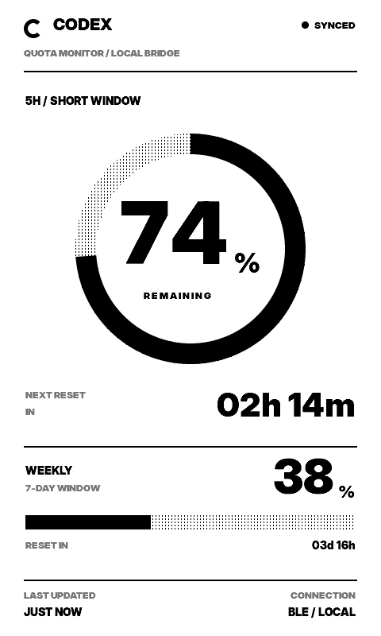
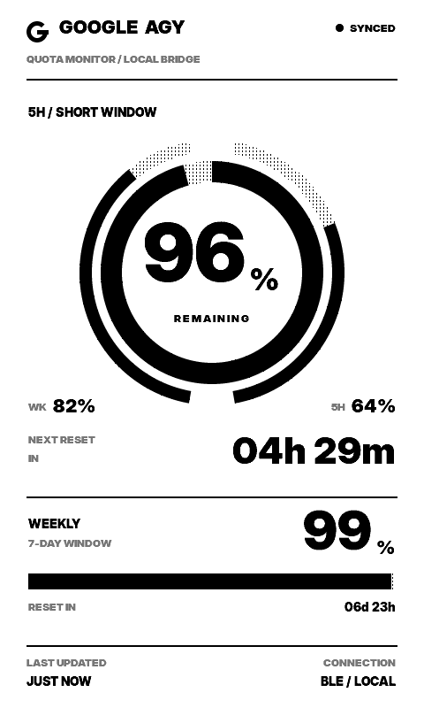

# Ink4 Codex Monitor

<p>
  
  
  
  
  
  
  
</p>

## 项目简介

将 **Codex** 与 **Google AGY（Antigravity）** 的剩余额度和重置倒计时实时显示在 **Metalio E-Ink 4** 墨水屏上，保留官方主页与全部原生应用。

- **双视图切换**：
  - **CODEX 视图**：大圆环展示 5 小时剩余额度，横条展示 7 天周额度与各自重置倒计时。
  - **GOOGLE AGY 视图**：内粗圆展示 Gemini 5H 剩余，外细双半圆左展示外部模型（Claude / GPT）周额度、右展示 5H 额度，下半屏展示 Gemini 5H 倒计时与周额度。
- **低功耗 BLE 同步**：电脑端 Python Bridge 读取本机已登录账号状态，通过蓝牙低功耗（BLE）每 **5 分钟**自动同步一次；设备空闲时自动进入 Light Sleep 并保持连接与屏幕常驻显示。
- **5H 周期自动激活**：检测到 5H 周期到期或满额空窗时，自动复用专用只读沙箱会话发送一条轻量探活消息（Codex 使用 `codex exec`，AGY 使用 `agy --model gemini-4-hydrogen-low ... --print="Reply with OK only."`）以开启新周期（可用 `--no-auto-activate` 关闭）。
- **无 AGY 纯净兼容**：未安装 `agy` CLI 时自动以纯 Codex 模式运行，不影响旧版固件或纯 Codex 用户。

### 界面预览（480 × 800 · 3:5 原生屏比）

<table>
  <tr>
    <th align="center">CODEX 视图</th>
    <th align="center">GOOGLE AGY 视图（底部右键切换）</th>
  </tr>
  <tr>
    <td align="center"></td>
    <td align="center"></td>
  </tr>
</table>

### 设备操作

- 开机主页点击 **Codex** 图标进入监控页（退出后自动停止 BLE 广播与连接）。
- 底部物理面板键：**左键**返回主页 · **中键**手动同步 · **右键**在 `CODEX` 与 `GOOGLE AGY` 之间切换。
- 触屏操作：点击左上角标题返回主页，点击左下角 `LAST UPDATED` 手动同步，侧边 `BOOT` 键单击也可同步。

---

## 兼容平台

| 维度 | 支持状态 |
| --- | --- |
| **硬件设备** | `Metalio E-Ink 4`（ESP32-S3 · 3.97" 480×800 SSD1677 · 16MB Flash，已真机验证） |
| **电脑后端** | `macOS (Apple Silicon)` · `Python 3.11+` · `BLE`（已验证） |
| **数据源** | `Codex CLI`（ChatGPT 套餐登录，纯 API Key 无 5H/周额度）· `Antigravity CLI (agy)`（可选） |
| **未适配平台** | `macOS Intel`、`Linux`、`Windows`（后端依赖 macOS 路径、LaunchAgent 与文件锁） |

---

## 安装与使用

### 1. 安装并启动电脑后端（Mac Bridge）

确保已安装 Python **3.11+** 与 `codex`（已执行 `codex login`）；如需同时看 AGY 额度，安装并登录 `agy` 即可（未安装会自动跳过）。开启 Mac 蓝牙并授予终端/Python 蓝牙权限。

```bash
git clone https://github.com/spinachx64/ink4-codex-monitor.git
cd ink4-codex-monitor
python3 -m venv .venv
.venv/bin/python -m pip install -r requirements.txt
```

先验证本地额度读取（纯只读，不连接蓝牙、不触发激活）：

```bash
mkdir -p .state
bash scripts/run_bridge.sh --once --provider app-server --state .state/quota-check.json
# 可选：验证 AGY 额度读取
bash scripts/run_bridge.sh --agy-once --state .state/agy-check.json
```

前台启动或安装为登录自启动（二选一，避免同时运行两个实例）：

```bash
# 前台运行
bash scripts/run_bridge.sh

# 或安装为 macOS LaunchAgent 登录自启动
bash scripts/setup_autostart.sh
```

常用参数与管理：

- 指定设备 / CLI 路径：`--device UUID`、`--codex /path/to/codex`、`--agy /path/to/agy`
- 关闭 AGY 或关闭自动周期激活：`--no-agy`、`--no-auto-activate`
- 后台服务日志与启停：
  ```bash
  tail -f ~/Library/Logs/CodexInkMonitor/bridge.log
  launchctl kickstart -k gui/$(id -u)/com.spinach.ink4-codex-monitor
  launchctl bootout gui/$(id -u)/com.spinach.ink4-codex-monitor
  ```

### 2. 编译并刷写设备固件

环境要求：Git、**ESP-IDF 5.5.4**（ESP32-S3 工具链，在终端先激活 `export.sh`）。

```bash
git clone https://github.com/CloudZao/Metalio-E-INK4.git ../Metalio-E-INK4
git -C ../Metalio-E-INK4 checkout d12f481f4a42420634bb56a928f3959a977367d4
python3 scripts/prepare_firmware.py --source ../Metalio-E-INK4

python -m pip install qoi-conv Pillow
bash scripts/build.sh
```

用支持数据传输的 USB-C 线连接设备（替换 `/dev/cu.usbmodemXXXX` 为 `ls /dev/cu.usbmodem*` 的实际端口），建议首次刷写前先备份原厂 Flash：

```bash
mkdir -p backups
python -m esptool --chip esp32s3 --port /dev/cu.usbmodemXXXX --baud 921600 read_flash 0 0x1000000 backups/original.bin

# 刷写固件与资源
idf.py -C build-firmware -p /dev/cu.usbmodemXXXX flash
```

后续升级已有构建副本，直接执行 `bash scripts/build.sh` 后运行 `idf.py -C build-firmware -p /dev/cu.usbmodemXXXX app-flash` 即可。
